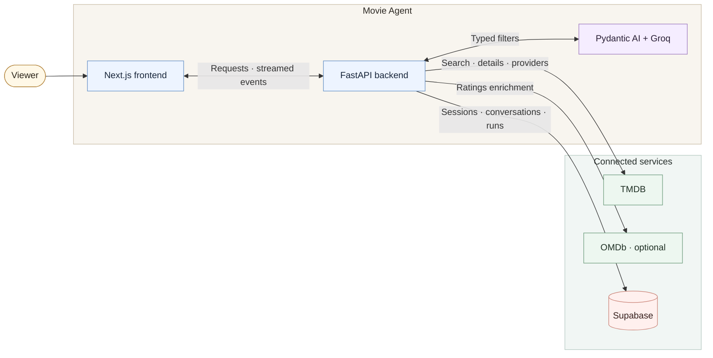

# Movie Agent

Movie Agent helps answer the deceptively difficult question: **what should I watch tonight?** It turns conversational requests such as “give me three 1990s dark romances” or “an action movie with Sylvester Stallone” into grounded, country-aware recommendations.

## Product Experience

Describe what you want in natural language. The agent can filter by genre, mood, release year or range, cast or crew, original language, maximum runtime, minimum TMDB rating, and similarity to a named movie. There is no fixed limit on how many of these filter types you can combine in one request; follow-up messages can refine them. Availability country controls where to check streaming options. Moods such as “dark” are treated as subjective preferences; factual filters are checked against movie data.

New searches return four recommendations by default. You can request between one and ten; the agent explains when it cannot find enough verified matches. It streams safe **predict → decide → act** activity and presents movie cards with posters, ratings, match explanations, and regional providers.

## How Suggestions Are Made

1. **Parse:** Groq turns your request into typed filters. Refinements carry forward preferences from the current conversation unless you change them.
2. **Search:** The backend asks TMDB for candidate movies and their details.
3. **Verify:** The backend checks factual filters against those details and shows matching movies in TMDB's discovery order. There is no personalized ranking. Mood is subjective; unclear requests get a clarification, and too few matches produce an explained shortfall.

## Architecture

- **Web app · Next.js** — conversation, filters, movie cards, and streamed updates.
- **API · FastAPI** — session checks, recommendation flow, and movie-fact verification.
- **Inference · Pydantic AI + Groq** — converts messages into typed preference updates.
- **Connected services** — TMDB for movie data, OMDb for optional ratings, and Supabase for session and conversation state.

## Data Sources

- **TMDB** provides movie metadata, artwork, credits, TMDB ratings, and country-specific watch-provider data. Watch-provider data is powered by JustWatch.
- **OMDb** optionally provides IMDb and Rotten Tomatoes ratings; recommendations continue if it is unavailable.
- **Supabase** stores anonymous sessions, conversations, runs, and usage data.

This product uses TMDB and the TMDB APIs but is not endorsed, certified, or otherwise approved by TMDB. Watch-provider data requires JustWatch attribution.

## Agent Tools

The agent uses bounded operations to ground each answer:

- `resolve_person` finds and disambiguates people named in a request.
- `search_movies` finds or disambiguates a referenced movie title.
- `discover_movies` retrieves candidates using the requested filters.
- `get_movie_details` checks candidate facts and hard constraints before recommendations are shown.
- `get_watch_options` retrieves providers for the selected country.
- `get_external_ratings` adds optional OMDb ratings when available.

The model extracts preferences and helps choose discovery steps. Application code verifies movie facts and enriches final results; the model does not supply movie facts from memory.

## Repository Layout

- `backend/` — FastAPI service, agent logic, provider clients, and backend tests.
- `frontend/` — Next.js application and browser tests.
- `supabase/` — database migrations and database tests.
